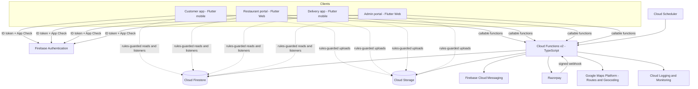
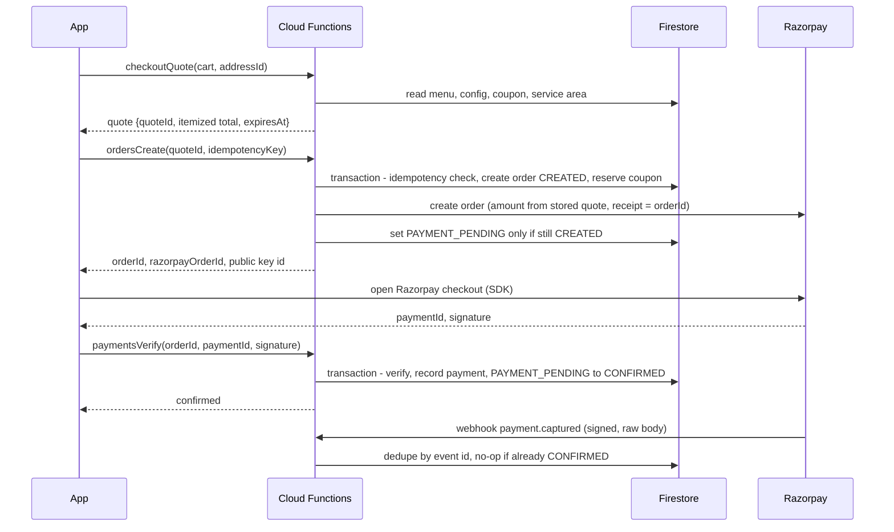

# ZestyGo — System Architecture

Version 1.0 · Companion to the PRD · Status: build-ready

## 1. Purpose and principles

ZestyGo is a food delivery platform made of four Flutter apps on one Firebase backend. This document defines how the pieces fit, where trust boundaries sit, and how failures are handled.

Guiding principles:

1. **Server-authoritative money and state.** Prices, totals, coupons, payment state, order status, refunds and delivery assignment are decided only in Cloud Functions.
2. **Clients read, functions write.** Clients may read narrowly scoped data directly from Firestore through rules. Almost every write to business data goes through a callable function. The only direct client writes are low-risk user-owned documents (cart, device tokens, profile display fields, favorites).
3. **Admin SDK bypasses rules, so every function authorizes itself** (identity, role, resource ownership, account status).
4. **Idempotency everywhere money or state changes.**
5. **Deny by default** in Firestore and Storage rules.
6. **Boring and bounded.** No unbounded arrays, no platform-wide listeners, no external calls inside transaction callbacks.

## 2. System context



## 3. Components

### 3.1 Applications

| App | Tech | Users | Notes |
|-----|------|-------|-------|
| customer_app | Flutter (Android, iOS) | Customers | Discovery, cart, checkout, tracking, reviews, support |
| restaurant_portal | Flutter Web | Owners, managers | Menu, orders with sound alerts, reports |
| delivery_app | Flutter (Android, iOS) | Delivery partners | Offers, navigation handoff, location sharing during active delivery |
| admin_portal | Flutter Web | Support, admins, super admins | Approvals, order tools, refunds, config, audit log |

### 3.2 Shared Dart packages

| Package | Responsibility |
|---------|----------------|
| design_system | Tokens (color, type, spacing, radius), theme, reusable widgets, motion helpers, skeletons |
| common_models | Typed domain models, enums mirroring backend (order status), Money in paise |
| common_services | Logging, analytics wrapper, error mapping, connectivity, feature flags |
| networking | Callable client wrapper, typed results, retry and timeout policy, error decoding |
| authentication | Auth repository, session and claims provider, role guards for GoRouter |
| location_services | Permission flow, location stream, geohash helpers, map utilities |

### 3.3 Backend modules (functions/src)

Each module follows **handler → service → repository**. Handlers validate input (zod) and authorize; services hold business rules; repositories are the only code touching Firestore for that module.

| Module | Responsibility |
|--------|----------------|
| auth, users | Provisioning, claims, addresses, consent, account deletion |
| restaurants, menus | Registration, profile, hours, menu CRUD, availability |
| cart, pricing | Cart validation, quote calculation (paise, taxes, fees) |
| coupons | Validation, reservation, redemption, release |
| orders | Creation, state machine, cancellation, events |
| payments, refunds | Razorpay orders, signature checks, webhooks, refunds, reconciliation |
| delivery | Partner lifecycle, offers, assignment, status, location |
| notifications | Event-driven FCM, in-app notification documents, token cleanup |
| reviews, support | Eligibility, aggregation, tickets |
| admin | Approvals, role assignment, suspension, config, audit |
| scheduled | Expiry, reconciliation, stuck-order alerts, cleanup |
| shared | Errors, auth guards, idempotency, validation, logging, config access |

## 4. Authentication and authorization

- **Identity:** Firebase Authentication (email and password, Google, phone OTP).
- **Roles:** server-set custom claims: `role` (customer, restaurant_owner, restaurant_manager, delivery_partner, support, admin, super_admin) and `restaurantId` for restaurant users. Clients can never write claims.
- **Claim lag:** claims refresh with the ID token (up to one hour unless forced). Functions therefore also read `users/{uid}.status` for suspension and `restaurants/{id}.status` or `delivery_partners/{uid}.status` for approval state on sensitive operations.
- **Provisioning:** an Auth `onCreate` trigger creates the user document with role `customer`; a callable `usersProvision` is the idempotent fallback if the trigger failed.
- **Privileged elevation:** restaurant and partner roles are assigned by registration functions or admin approval flows; admin roles only by a super admin through `adminSetRole`.
- **Sensitive actions:** require recent authentication (`auth_time` within 5 minutes) and, for admins, a second factor.
- **App Check** reduces abuse from unofficial clients. It is not authorization.

## 5. Order and payment flow



Key rules:

- The Razorpay call happens **outside** the Firestore transaction. The order is created first; the provider call is retried safely because the receipt equals the order ID and the idempotency record tracks progress.
- Verification and webhook handlers both call the same `confirmPayment(orderId, providerPayment)` service. Whichever arrives first wins; the second is a no-op.
- The client reporting success never marks an order paid.
- A payment captured after the order expired triggers an automatic refund.

The full state machine is in the PRD (section 5) and implemented in `functions/src/orders/stateMachine.ts`. Orders carry two tracks: **order status** and **delivery status**.

## 6. Delivery assignment and tracking

- MVP: admin-assisted assignment (`adminAssignDelivery`) plus optional nearest-available auto-assignment behind the feature flag `autoAssignment`.
- Offers live in `deliveries/{orderId}/offers/{partnerId}` with an expiry. Accepting is a transaction that succeeds only if the delivery is still OFFERED to that partner.
- **Location:** the assigned partner calls `deliveriesPostLocation` every 10 seconds while moving (minimum 20 m change). The function validates assignment and active state, then overwrites a single document `delivery_locations/{orderId}`. The customer listens to that one document while `active == true`. History is not stored; the document is deleted after delivery.
- Stale handling: the app labels data older than 60 seconds and falls back to status-only tracking.
- Alternative considered: direct rules-guarded partner writes (cheaper, fewer invocations). Rejected for MVP because server-side throttling and geo sanity checks are easier in functions. Revisit if invocation cost becomes material.

## 7. Flutter architecture

- **Structure:** feature-first. Each feature has `data` (repositories, DTOs), `domain` (models, use cases where they add value) and `presentation` (screens, widgets, controllers).
- **State:** Riverpod (providers for dependencies and `AsyncNotifier` controllers). No business pricing logic in Flutter; the UI displays server quotes.
- **Navigation:** GoRouter with redirect guards reading the auth/claims provider; deep links for notifications.
- **Errors:** repositories convert exceptions to a typed `AppFailure`; UI maps failures to messages; unexpected errors go to Crashlytics (mobile) with no personal data.
- **Offline:** Firestore persistence on mobile for reads; writes that need the server show clear offline states instead of silent queueing (orders, payments).
- **Environments:** `--dart-define=ENV=dev|staging|prod` selects Firebase options.

Layout of each app:

```
lib/
  app/        app widget, router, theme wiring
  core/       env, bootstrap, error handling, logging
  features/   one folder per feature (data, domain, presentation)
test/         mirrors lib
```

## 8. Data access strategy

- Lists are paginated (20 per page) with cursor queries.
- Listeners: customer listens to **one** order and **one** location document; restaurant listens to its **active** orders (statuses CONFIRMED to READY_FOR_PICKUP); partner listens to its active delivery and offers; admin dashboards read pre-aggregated stats documents. Nothing listens to platform-wide collections.
- Listeners are created in providers with `autoDispose` and cancelled on sign-out.
- Menu and restaurant documents are cached by the Firestore SDK and images by the image cache.

## 9. Search strategy

| Need | MVP approach | Limit |
|------|--------------|-------|
| Restaurant by name or cuisine | `searchTokens` (lowercased name tokens, max 10) with `array-contains` plus filters | Single token match, no typo tolerance, no ranking |
| Dish search | Collection-group query on `menu_items.nameTokens` with `restaurantApproved == true` | Same as above; no cross-field relevance |
| Nearby | Geohash range queries (geofire-common) plus `serviceAreaIds` | Needs composite indexes per filter combination |

When to adopt a dedicated provider (Algolia, Typesense or Elastic): typo tolerance or relevance ranking is required, more than a few thousand restaurants or about 100,000 menu items exist, or filter combinations make index management painful. A Firestore trigger would then sync documents to the provider. The app talks to a `SearchRepository` interface so the swap does not touch UI code.

## 10. Notifications

- Backend triggers on order event documents create an in-app notification document (id = `{eventId}_{userId}`) and then send FCM. Using the event ID as the document ID makes retries idempotent.
- Payloads carry order ID and a short title only; no addresses or phone numbers.
- Invalid tokens reported by FCM are deleted. Promotional messages require consent flags.

## 11. Scheduled jobs

| Job | Frequency | Purpose |
|-----|-----------|---------|
| expireUnpaidOrders | 1 min | PAYMENT_PENDING and PAYMENT_FAILED past expiry to EXPIRED; release coupons |
| autoRejectUnacceptedOrders | 1 min | CONFIRMED with no restaurant response for 5 min to REJECTED, start refund |
| expireDeliveryOffers | 1 min | Move to next candidate or unassigned alert |
| reconcilePayments | 15 min | Compare pending payments and refunds with Razorpay |
| detectStuckOrders | 5 min | Raise alerts for orders without progress |
| cleanupLocations | hourly | Delete location documents for finished deliveries |
| rollupStats | 5 min | Update daily aggregate documents |

## 12. Environments and configuration

| Environment | Firebase project | Purpose |
|-------------|------------------|---------|
| dev | zestygo-dev | Local and shared development; Razorpay test keys |
| staging | zestygo-staging | Pre-release verification; Razorpay test keys |
| prod | zestygo-prod | Live; Razorpay live keys; deployments need manual approval |

- Secrets (Razorpay key secret, webhook secret, Maps server key) live in Firebase Functions secrets (Secret Manager) per project.
- Public identifiers (Razorpay key ID, restricted Maps client keys) are passed through build-time defines or remote config.
- Platform behavior (fees, taxes, flags, service areas) lives in Firestore `platform_config` and `service_areas`, versioned and audited.

## 13. Observability

- Structured JSON logs with `requestId`, `uid`, `orderId`, `fn` fields; no PII.
- Crashlytics, Analytics and Performance Monitoring on mobile.
- Alerts: payment verification failures, webhook signature failures, function error rate, stuck orders, refund failures, spend budget thresholds.

## 14. Failure handling

| Failure | Behavior |
|---------|----------|
| Client retries a request | Idempotency key returns the original result |
| App killed after paying | On reopen the app reads the order from the server; webhook confirms |
| Webhook before verify call, or duplicated | Dedupe by provider event ID; `confirmPayment` is idempotent |
| Razorpay API down during order create | Order stays CREATED; function returns a retryable error; same key resumes |
| Function crashes mid-way | In-progress idempotency record expires after 2 minutes and can be resumed; schedulers repair stuck states |
| FCM fails | In-app state is authoritative; notification document remains |
| Maps unavailable | Address entry falls back to manual; tracking shows status only |
| Partner offline | Offer expires; next candidate or admin alert |
| Firestore contention on hot documents | Use per-day or sharded counters; avoid single global counters |

## 15. Scalability and cost

Likely bottlenecks and when to evolve:

| Area | Risk | Trigger and response |
|------|------|----------------------|
| Hot documents (counters, stats) | Firestore sustained write limit per document | Shard counters once a document sees close to 1 write per second |
| Location writes | Cost and invocation volume | Increase interval, move to rules-guarded direct writes, or Realtime Database |
| Search | Prefix-only | Move to a search provider (section 9) |
| Admin analytics | Aggregates insufficient | Export to BigQuery |
| Matching | Simple nearest search | Dedicated assignment service |

Main cost drivers: Firestore reads (feeds and listeners), writes (orders, events, locations), function invocations, Maps (autocomplete, routes, map loads), phone OTP SMS, Cloud Storage bandwidth, FCM (free), Razorpay fees. A cost model with launch assumptions (orders per day, reads per session, location updates per delivery) accompanies the release checklist; the architecture is not claimed to scale without limit.

## 16. Repository layout

```
zestygo/
  apps/            customer_app, restaurant_portal, delivery_app, admin_portal
  packages/        design_system, common_models, common_services, networking,
                   authentication, location_services
  functions/       src (modules), test (unit, rules)
  docs/            PRD, ARCHITECTURE, DATABASE_SCHEMA, API_SPECIFICATION, SECURITY,
                   DEPLOYMENT, TESTING_STRATEGY, adr/
  scripts/         setup.sh, emulators.sh, test-all.sh
  .github/         CI and deploy workflows
  firebase.json, .firebaserc, firestore.rules, firestore.indexes.json, storage.rules
  melos.yaml, analysis_options.yaml, .env.example, README.md
```

## 17. Architecture decision records

| ADR | Decision |
|-----|----------|
| 0001 | Firebase backend with all privileged logic in Cloud Functions |
| 0002 | Single-restaurant cart for MVP |
| 0003 | Two-track order and delivery status model |
